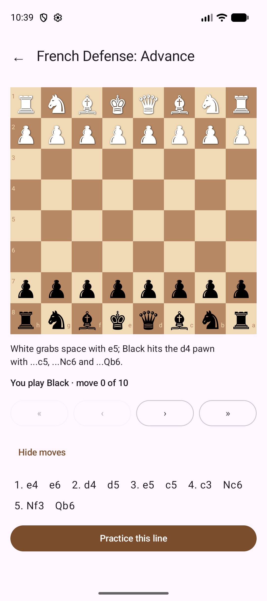

# Opening Trainer

An Android app for learning chess openings. Pick an opening, step through its main line, then
practice it against the app: you play your side, the app answers with the book replies, and every
move you make is graded against the line.

## Features

- **Opening list** — nine openings (1.e4, 1.d4 and flank), filterable by first move, each card
  showing the first moves, the side you train as and your practice record.
- **Study** — step through the line with « ‹ › », jump to any move from the move list, last move
  highlighted on the board. The board flips when you train as Black.
- **Practice** — tap a piece to see its legal squares, then tap a target. Any legal move is
  allowed and graded:
  - ✓ **Book move** — the line continues and the opponent replies after a short pause.
  - **Good move, other opening** — the move leads into another opening from the catalog; it is not
    counted as a mistake, but the drill asks for its own line.
  - ✗ **Not a book move** — counted as a mistake, the square turns red.
  - **Hint** highlights the piece to move. At the end a result card shows your mistakes and the
    result is saved to the list.

## Architecture

```
model/        Chess.kt            Piece, PieceColor, ChessPosition (wraps chesslib)
data/         Opening.kt          Opening, OpeningProgress
              OpeningCatalog.kt   opening lines in standard notation
              OpeningRepository.kt interface + in-memory implementation
ui/components ChessBoard, BoardWithPanel, MoveList, OpeningCard, AppTopBar
ui/list       OpeningListScreen + OpeningListViewModel
ui/study      StudyScreen + StudyViewModel
ui/practice   PracticeScreen + PracticeViewModel
ui/           AppNavHost, OpeningArguments
AppContainer  the single repository instance shared by every screen
```

- **UI / state / logic are separated.** Screens are stateless about the game; each ViewModel owns
  a `StateFlow` of an immutable UI state, and the screens collect it with
  `collectAsStateWithLifecycle`.
- **State hoisting.** `ChessBoard` takes the board, orientation, highlights and an
  `onSquareClick` callback; it holds no state of its own.
- **Rotation.** Move position, mistakes and the opponent's pending reply live in the ViewModel,
  which survives configuration changes; the opponent reply runs in `viewModelScope`. The selected
  square and the move-list toggle use `rememberSaveable`.
- **Navigation.** Routes `list`, `study/{openingId}`, `practice/{openingId}`; the id reaches the
  ViewModel through `SavedStateHandle`.
- **Rules.** [chesslib](https://github.com/bhlangonijr/chesslib) parses the opening lines and
  generates legal moves. Only `ChessPosition` talks to it; the UI sees a plain
  `Map<String, Piece>`.
- **Part 2.** Progress persistence moves to Room by adding a new `OpeningRepository`
  implementation; nothing else changes.

## Running

Open the folder in Android Studio and run the `app` configuration, or from a terminal:

```
./gradlew :app:installDebug
./gradlew :app:testDebugUnitTest
```

Requires JDK 17+ and Android SDK 37; min SDK 24.

## Screenshots

| Study | 
|---|
|  |
