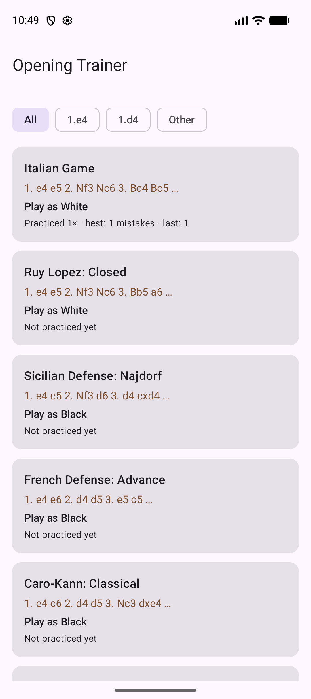
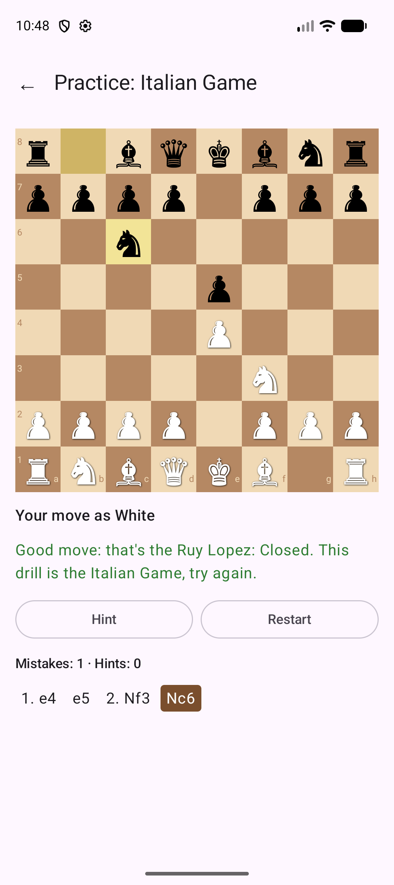
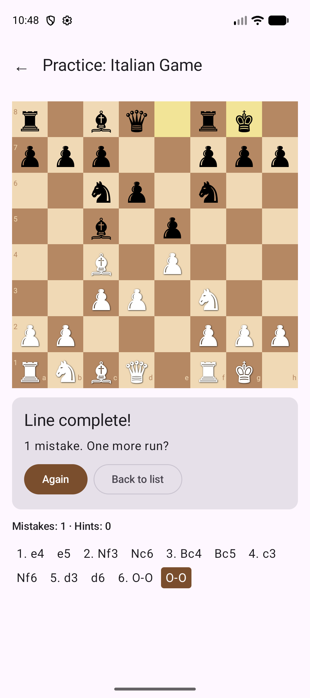
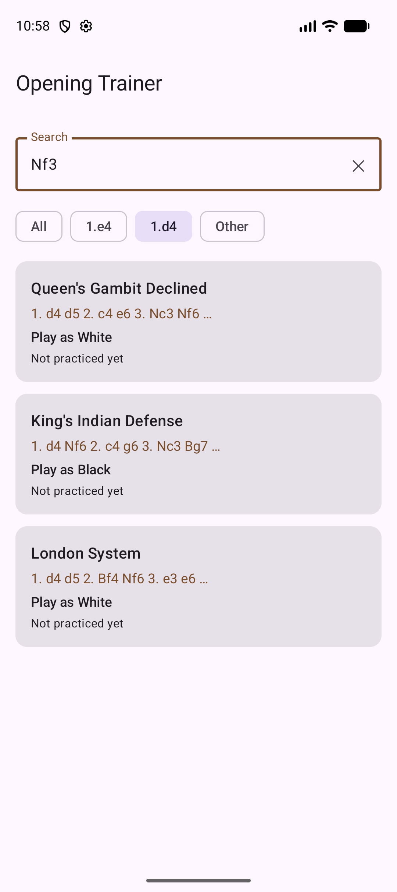
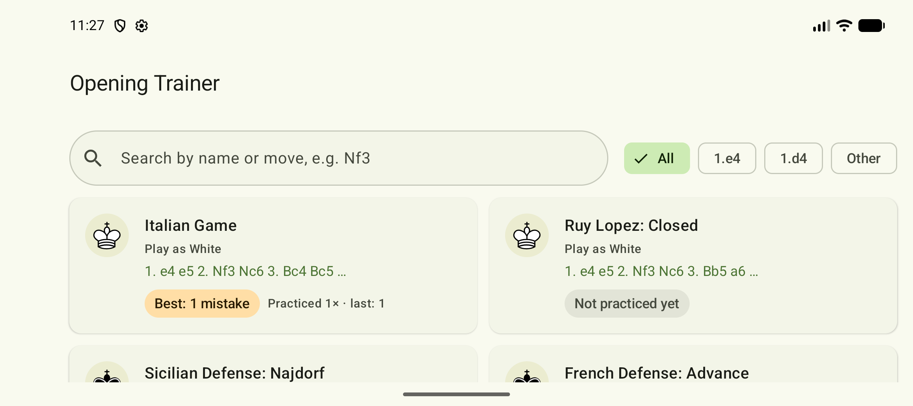
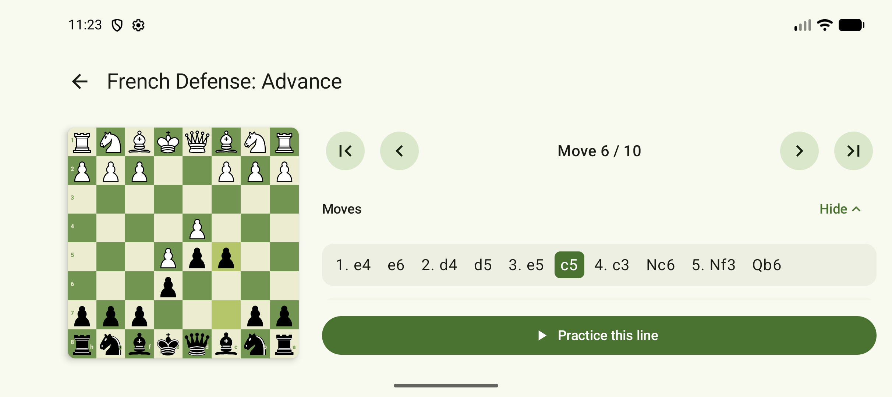
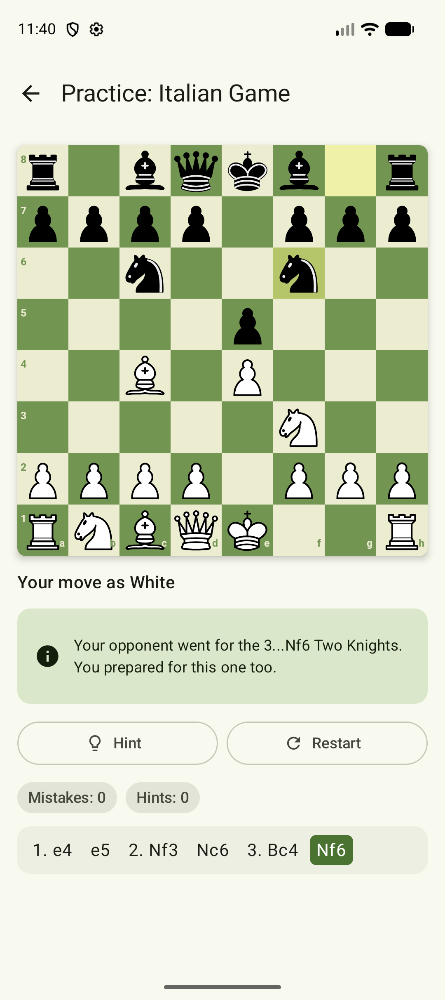

# Opening Trainer

An Android app for learning chess openings. Pick an opening, step through its main line, then
practice it against the app: you play your side, the app answers with the book replies, and every
move you make is graded against the line.

## Features

- Opening list: nine openings (1.e4, 1.d4 and flank). Search by name or by a move in the line
  ("Najdorf", "Nf3"), and filter by first move. Each card shows the side you train as, the first
  moves and your best result. In landscape the cards sit in two columns.
- Study: step through the line with the first / previous / next / last buttons or tap any move in
  the move list. The last move is highlighted, and the board flips when you train as Black.
  "Practice this opening" stays pinned at the bottom.
- Lines: the Italian, the Najdorf and the London come with sidelines, so the opponent doesn't
  always play the main line (for example 3...Nf6 in the Italian, 2.c3 against the Najdorf). Your
  own moves stay the same, and only the opponent's replies branch. Study has a chip for each line, and
  Practice picks a line you haven't played yet, then cycles through them. When the opponent
  leaves the main line, the banner names the sideline.
- Practice: tap a piece to see its legal squares (a dot for a move, a ring for a capture), then
  tap where it goes. Any legal move is allowed, and a feedback banner grades it:
  - The book move turns the banner green, and the opponent replies 0.6 s later.
  - A move that leads into another opening from the catalog isn't a mistake, but the drill asks
    for its own line (amber banner).
  - Any other move counts as a mistake and turns the banner and the square red.

  Hint highlights the piece to move. When the line ends, a result card shows your mistakes and
  hints, and the list saves your best result.
- Light and dark themes in the board's green.

## Architecture

```
model/        Chess.kt            Piece, PieceColor, ChessPosition (wraps chesslib)
data/         Opening.kt          Opening, OpeningProgress
              OpeningCatalog.kt   opening lines in standard notation
              OpeningRepository.kt interface + in-memory implementation
ui/components ChessBoard, PieceImage, BoardWithPanel, MoveList, OpeningCard, Pills, AppTopBar
ui/theme      Theme.kt            light and dark color schemes
ui/list       OpeningListScreen + OpeningListViewModel
ui/study      StudyScreen + StudyViewModel
ui/practice   PracticeScreen + PracticeViewModel
ui/           AppNavHost, OpeningArguments
AppContainer  the single repository instance shared by every screen
```

- State: screens hold no game state. Each ViewModel owns a `StateFlow` of an immutable UI state,
  and the screens collect it with `collectAsStateWithLifecycle`. The search text is a
  `TextFieldState` held by `OpeningListViewModel`, which combines it with the filter and the saved
  progress.
- State hoisting: `ChessBoard` takes the board, orientation, highlights and an `onSquareClick`
  callback, and keeps nothing of its own.
- Rotation: the move position, mistakes and the opponent's pending reply live in the ViewModel,
  which survives configuration changes, and the reply runs in `viewModelScope`. The selected
  square and the move-list toggle use `rememberSaveable`; `remember` caches the board highlights
  in Practice.
- Layout: `BoardWithPanel` puts the panel under the board in portrait and next to it in
  landscape, with an optional footer that stays on screen in both.
- Navigation: routes `list`, `study/{openingId}` and `practice/{openingId}`. The id reaches the
  ViewModel through `SavedStateHandle`.
- Rules: [chesslib](https://github.com/bhlangonijr/chesslib) parses the opening lines and
  generates legal moves. Only `ChessPosition` talks to it, so the UI sees a plain
  `Map<String, Piece>`.
- Part 2: saving progress to Room means adding a new `OpeningRepository` implementation. Nothing
  else changes.

## How to run

You need Android Studio, JDK 17 or newer, and an emulator or phone running Android 7.0 (API 24)
or higher. The app compiles against API 37.

1. Open the repository folder in Android Studio and wait for the Gradle sync.
2. Pick an emulator or a connected phone and press **Run**.

From the command line, with a device connected:

```bash
./gradlew :app:installDebug
./gradlew :app:testDebugUnitTest
```

On Windows use `gradlew.bat` instead of `./gradlew`.

## Screenshots

| Opening list | Study | Practice feedback | Result |
|---|---|---|---|
|  |  |  |  |

| Search |
|---|
|  |

| Landscape list | Landscape study | Sideline |
|---|---|---|
|  |  |  |

## Credits

- Chess pieces: the "cburnett" set by Colin M.L. Burnett, taken from
  [Lichess](https://github.com/lichess-org/lila/tree/master/public/piece/cburnett), which
  distributes it under GPLv2+. The originals on Wikimedia Commons are also offered under GFDL and
  BSD. Converted to Android vector drawables in `app/src/main/res/drawable/piece_*.xml`.
- First, last and hint icons: Google's Material icons, Apache 2.0.
